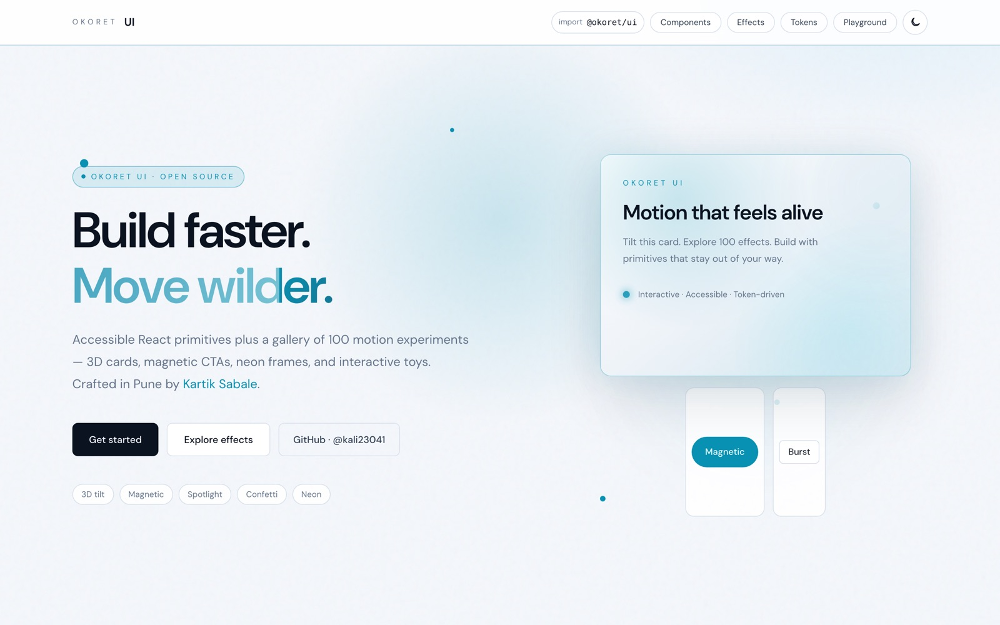
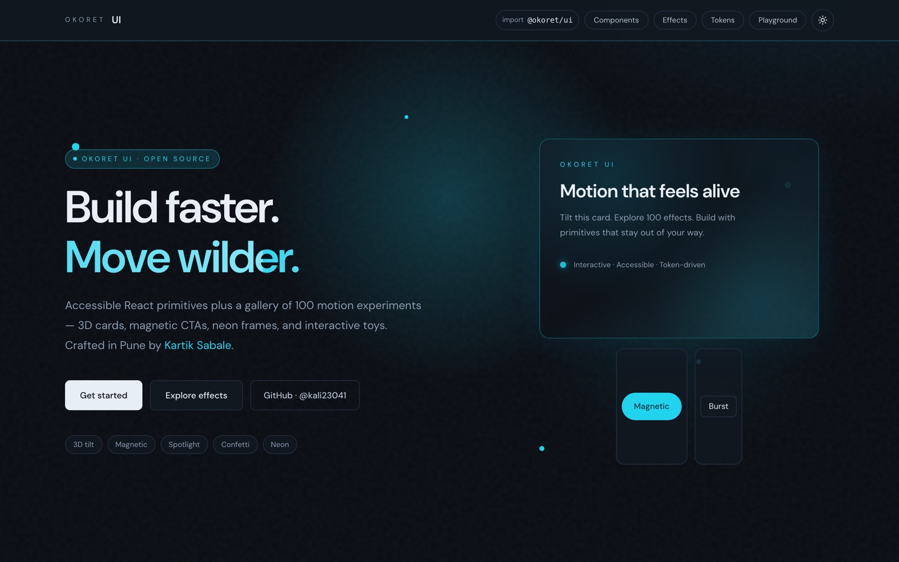
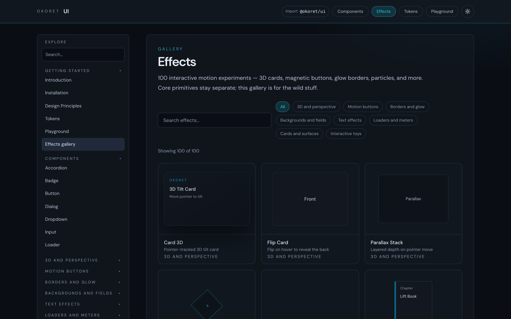
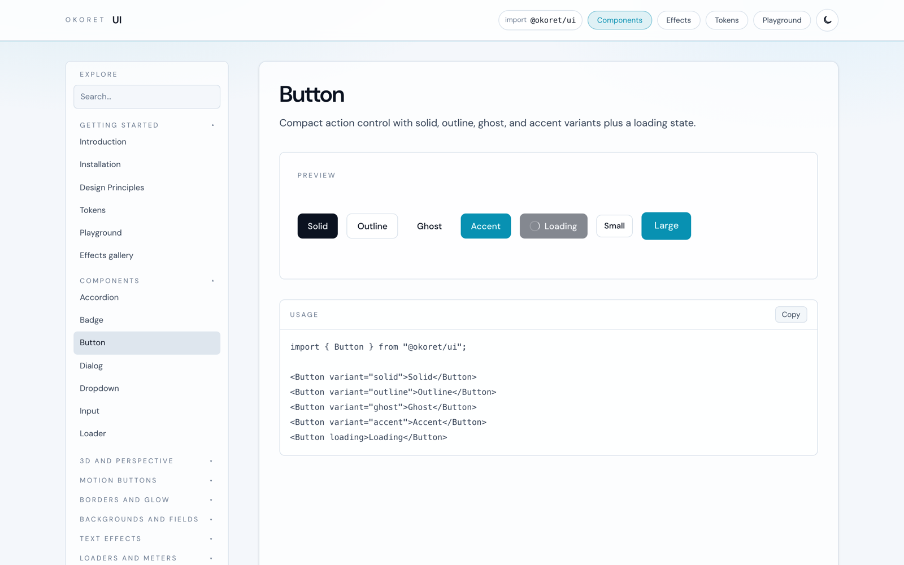
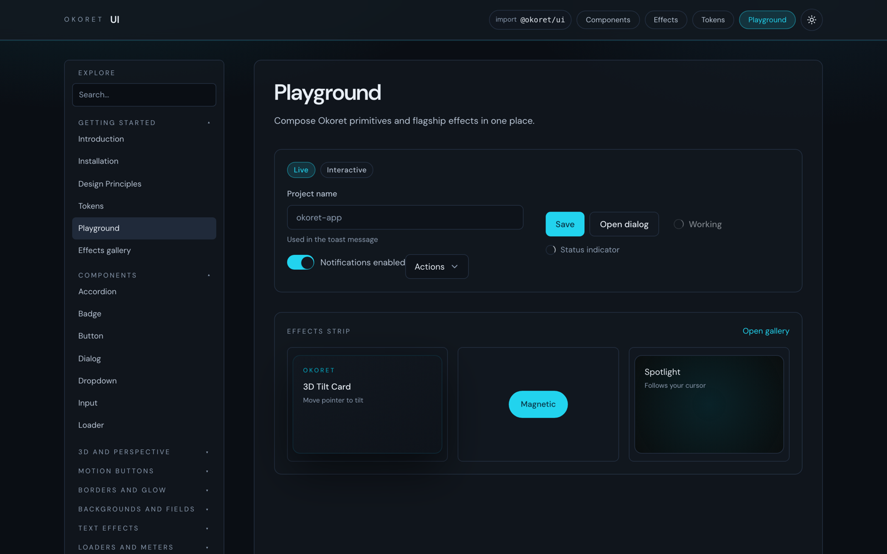
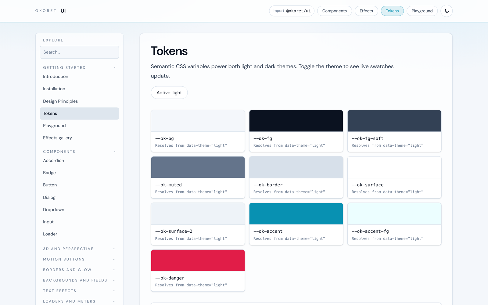

# Okoret UI

<p align="center">
  
</p>

<p align="center">
  <strong>Open-source React component library</strong><br />
  Accessible primitives · Token-driven theming · 100 motion effects
</p>

<p align="center">
  <a href="https://github.com/kali23041/Okoret-UI/stargazers"></a>
  <a href="https://github.com/kali23041/Okoret-UI/blob/main/LICENSE"></a>
  <a href="https://github.com/kali23041/Okoret-UI"></a>
  <a href="https://github.com/kali23041/Okoret-UI"></a>
  <a href="https://github.com/kali23041/Okoret-UI"></a>
  
</p>

<p align="center">
  <a href="#quick-start">Quick start</a> ·
  <a href="#components">Components</a> ·
  <a href="#effects-gallery">Effects</a> ·
  <a href="#theming">Theming</a> ·
  <a href="#portfolio">Portfolio</a> ·
  <a href="https://kartiksabale.com">kartiksabale.com</a>
</p>

---

## Preview

Light and dark themes out of the box — toggle persists across sessions.

| Light | Dark |
| :----: | :----: |
|  |  |

| Effects gallery | Component docs |
| :----: | :----: |
|  |  |

| Playground | Design tokens |
| :----: | :----: |
|  |  |

---

## Why Okoret?

Okoret UI is a **controlled surface-area** library: fewer primitives, stronger defaults, and a separate gallery for experimental motion. Built for real product UIs first — then for the wild demos that make a portfolio memorable.

| | |
|---|---|
| **9 core primitives** | Accordion, Badge, Button, Dialog, Dropdown, Input, Loader, Switch, Toast |
| **100 effects** | 3D tilt, magnetic CTAs, neon frames, loaders, particles, and more |
| **Dual theme** | Light (Arctic Ink) + dark (Midnight Cyan) via CSS tokens |
| **Accessible** | Keyboard support, focus rings, ARIA patterns, `prefers-reduced-motion` |
| **Zero runtime CSS-in-JS** | Tailwind 4 + semantic CSS variables |

---

## Quick start

```bash
git clone https://github.com/kali23041/Okoret-UI.git
cd Okoret-UI
npm install
npm run dev
```

Open the URL Vite prints (usually `http://localhost:5173/`). Routes use HashRouter — e.g. `/#/effects`, `/#/components/button`.

### Use the library locally

Components live in `src/lib` and resolve through a Vite alias:

```js
// vite.config.js
import { defineConfig } from 'vite'
import path from 'path'

export default defineConfig({
  resolve: {
    alias: {
      '@okoret/ui': path.resolve(__dirname, './src/lib'),
    },
  },
})
```

```jsx
import {
  Button,
  Dialog,
  ToastProvider,
  ThemeProvider,
  Card3D,
  EFFECTS,
  useTheme,
} from '@okoret/ui'

export function App() {
  return (
    <ThemeProvider>
      <ToastProvider>
        <Button variant="accent">Get started</Button>
        <Card3D />
      </ToastProvider>
    </ThemeProvider>
  )
}
```

> **Note:** npm registry publishing is not set up yet. Use the local alias, or copy modules from `src/lib` into your app.

---

## Components

| Component | Description |
|-----------|-------------|
| **Button** | Solid, outline, ghost, accent + loading state |
| **Input** | Labeled field with focus ring |
| **Switch** | Accessible toggle |
| **Dialog** | Modal with overlay + escape / focus handling |
| **Dropdown** | Compact menu trigger |
| **Accordion** | Expandable sections |
| **Toast** | Imperative notifications via `useToast` |
| **Badge** | Status chips (default, accent, muted, danger) |
| **Loader** | Spinner control |

Browse demos at `/#/components` and each `/#/components/:name` page.

```jsx
import { Button, useToast, ToastProvider } from '@okoret/ui'

function Example() {
  const { toast } = useToast()
  return (
    <Button
      variant="accent"
      onClick={() => toast({ title: 'Saved', description: 'Changes are live.' })}
    >
      Save
    </Button>
  )
}
```

---

## Effects gallery

**100** registry-driven experiments across 8 categories — kept separate from core primitives so product UIs stay calm while demos stay wild.

| Category | Examples |
|----------|----------|
| 3D and perspective | Card 3D, Flip Card, Parallax Stack, Cube Spin |
| Motion buttons | Magnetic, Neon Pulse, Shimmer CTA, Ripple Burst |
| Borders and glow | Animated Gradient Border, Neon Frame, Aurora Edge |
| Backgrounds and fields | Mesh Gradient, Particle Drift, Spotlight Bg |
| Text effects | Glitch Text, Neon Sign, Scramble Hover |
| Loaders and meters | Orbit Loader, DNA Spinner, Liquid Progress |
| Cards and surfaces | Holo Card, Glass Card, Spotlight Card |
| Interactive toys | Confetti Burst, Marquee Strip, Radar Ping |

```jsx
import { EFFECTS, Card3D, MagneticButton } from '@okoret/ui'

// All effects
EFFECTS.map((e) => e.slug)

// Specific demos
<Card3D />
<MagneticButton />
```

Open `/#/effects` or any demo at `/#/effects/:slug`.

---

## Theming

Semantic tokens power both themes. Set `data-theme="light"` or `data-theme="dark"` on `<html>` (handled by `ThemeProvider`).

```css
[data-theme="light"] {
  --ok-bg: #f4f7fb;
  --ok-fg: #0b1220;
  --ok-accent: #0891b2;
}

[data-theme="dark"] {
  --ok-bg: #0a0e14;
  --ok-fg: #e8eef5;
  --ok-accent: #22d3ee;
}
```

```jsx
import { ThemeProvider, useTheme } from '@okoret/ui'

function ThemeToggle() {
  const { theme, toggleTheme } = useTheme()
  return <button onClick={toggleTheme}>{theme}</button>
}
```

Preference is stored in `localStorage` under `okoret-theme`, with system preference as fallback. See `/#/tokens` for live swatches.

---

## Docs map

| Route | Page |
|-------|------|
| `/#/` | Landing — interactive hero + featured effects |
| `/#/components` | Introduction |
| `/#/installation` | Setup guide |
| `/#/design-principles` | Design philosophy |
| `/#/tokens` | CSS token swatches |
| `/#/playground` | Compose primitives live |
| `/#/effects` | Full effects gallery |
| `/#/effects/:slug` | Single effect demo |
| `/#/components/*` | Per-component docs |

---

## Stack

- **React 19** + **Vite 7**
- **Tailwind CSS 4** (`@tailwindcss/vite`)
- **react-router-dom** (HashRouter)
- DM Sans + semantic CSS variables — no CSS-in-JS runtime

---

## Project structure

```
Okoret-UI/
├── public/okoret.svg
├── docs/screenshots/     # README previews
├── src/
│   ├── App.jsx
│   ├── index.css         # Theme tokens + motion CSS
│   ├── lib/              # @okoret/ui (primitives + effects)
│   │   ├── effects/      # 100 demos + registry
│   │   ├── theme.jsx
│   │   └── index.js
│   ├── components/       # Docs chrome (Header, sidebar, …)
│   └── pages/            # Landing + documentation
└── vite.config.js
```

---

## Development

```bash
npm install
npm run dev      # local docs site
npm run lint
npm run build    # production build
npm run preview  # preview dist/
```

1. Edit primitives / effects in `src/lib`
2. Update docs pages in `src/pages`
3. Run `npm run lint` and `npm run build` before opening a PR

---

## Contributing

Contributions are welcome — this is an open-source project.

1. Fork the repo and create a focused branch
2. Keep PRs small (one idea per PR)
3. Match existing patterns (tokens, accessibility, motion)
4. Run `npm run lint` and `npm run build`

Ideas that fit well: new effects (with registry entry), a11y fixes, docs polish, theme tokens, and playground compositions.

---

## Portfolio

Okoret UI is a flagship open-source project by **[Kartik Sabale](https://kartiksabale.com)** — full-stack developer (React, Next.js, Flutter, Node) based in Pune.

| | |
|---|---|
| **Role** | Creator & maintainer |
| **Portfolio** | [kartiksabale.com](https://kartiksabale.com) |
| **GitHub** | [@kali23041](https://github.com/kali23041) |
| **Repo** | [github.com/kali23041/Okoret-UI](https://github.com/kali23041/Okoret-UI) |

**Portfolio talking points**

- Shipped a motion-forward component system with dual theming and accessible primitives
- Built a searchable docs site (landing, demos, playground, token explorer)
- Authored **100** interactive effects with a registry-driven architecture
- Designed token-first CSS (light / dark) without a runtime styling engine

If you use Okoret in a project or portfolio write-up, a star on GitHub is appreciated.

---

## License

[MIT](LICENSE) © Okoret UI — crafted by [Kartik Sabale](https://kartiksabale.com)
